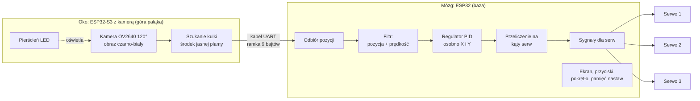

# 01. Jak to działa

Powrót do spisu: [[Projekt Ball Balancer]]. Nieznane słowo? Zajrzyj do [[02 Słowniczek]].

## W skrócie

Budujemy stół, który **sam balansuje kulką**. Na okrągłej tacy (średnica 210 mm) leży piłeczka pingpongowa. Kamera nad tacą widzi, gdzie jest piłeczka. Układ elektroniczny liczy, jak przechylić tacę, żeby piłeczka została w zadanym miejscu albo pojechała po wybranym torze (np. po okręgu). Taca jest przechylana przez trzy serwa ustawione co 120°.

Całość działa **samodzielnie**, bez komputera i bez Wi-Fi. Nastawy zmieniamy lokalnie: ekran OLED, cztery strzałki, przycisk DALEJ i pokrętło.

## Z czego się składa

## Dlaczego dwa mikrokontrolery (dwa ESP32)

Jeden układ musiałby robić naraz trzy rzeczy: łapać obrazy z kamery, liczyć regulator i odświeżać ekran. Odświeżenie ekranu OLED zajmuje kilkadziesiąt milisekund, a w tym czasie regulator mógłby przegapić klatkę z kamery albo spóźnić ruch serw. Przy balansowaniu kulką każde opóźnienie powoduje drżenie.

Dlatego **kamera ma własny układ** (tylko widzi i wysyła pozycję), a **baza ma swój** (sterowanie, ekran, przyciski). Rozmawiają przez kabel UART. Ramka z pozycją ma 9 bajtów i leci poniżej 0,1 ms, więc praktycznie nic nie kosztuje. Szczegóły: [[20 Firmware - Protokół UART]].

## Dlaczego trzy serwa co 120° (układ 3-RRS)

Żeby pochylić tacę w dowolną stronę, potrzeba minimum trzech punktów podparcia, które się unoszą lub opadają. Trzy serwa rozmieszczone równomiernie dają symetryczny, sztywny układ, a każdy punkt tacy jest podparty tak samo. Kinematykę (jak z wysokości punktów policzyć kąty serw) opisuje [[06 Kinematyka i zakres ruchu]].

## Dlaczego kamera na pałąku z góry

Kamera patrząca prosto w dół widzi całą tacę i pozycja kulki to po prostu jej położenie na obrazie (po prostej korekcji). Nie wymaga to czujników dotykowych, które psują ruch kulki. Jeden pałąk (C-Arm) zamiast dwóch słupków oszczędza materiał i ułatwia dostęp do tacy. Szczegóły: [[09 Kamera i wizja]] i [[17 Taca, pałąk i baza]].

## Co uznamy za sukces

1. Piłeczka pingpongowa stoi w środku: odchylenie standardowe pozycji $\le 3$ mm przez 60 s.
2. Po szturchnięciu piłeczka wraca do środka w $\le 3$ s.
3. Okrąg o promieniu 60 mm przy $\omega=1{,}5$ rad/s (jedno okrążenie w ok. 4,2 s): błąd śledzenia $\le 10$ mm.
4. Po utracie kamery lub kulki taca spokojnie się poziomuje, a po restarcie wracają zapisane nastawy.
5. Całość działa z jednego zasilacza 5 V, bez PC.

Kryterium 3 wymaga feed-forward i zmierzonego $K$ kulki (błąd modelu o 20% już zbliża nas do 10 mm), więc w razie potrzeby wolniejszy tor (1,0 rad/s) jest uczciwym planem awaryjnym ([[12 Trajektorie]]).

Te kryteria mierzymy na końcu w [[19 Plan prac i testy]].
