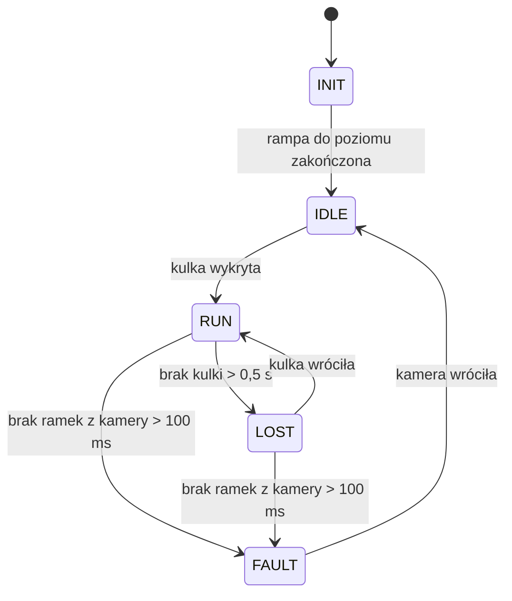

# 22. Firmware: sterowanie (mózg)

Powrót: [[Projekt Ball Balancer]]. Wiedza stojąca za kodem: [[06 Kinematyka i zakres ruchu]], [[11 Regulator PID]], [[15 Konsola i obsługa]].

> [!warning] Status kodu
> Poniższe fragmenty to **szkielet ustaleń**, nie gotowy projekt. Wzór kinematyki odwrotnej sprawdziłem numerycznie w Pythonie, ale kod C++ **nie był kompilowany ani uruchamiany na sprzęcie**. Pełny firmware powstanie po Etapie 5 ([[19 Plan prac i testy]]).

## W skrócie

Główny ESP32 ma dwa rdzenie. **Rdzeń 1** robi wszystko, co ma terminy (pozycja → regulator → serwa) i nie może się spóźnić. **Rdzeń 0** robi wszystko, co jest dla człowieka (ekran, przyciski, zapis) i może poczekać.

## Podział na rdzenie

| Rdzeń | Zadanie | Częstotliwość |
| :--- | :--- | :--- |
| Core 1 | Odbiór UART, filtr α-β, PID, kinematyka odwrotna, PWM | stałe 50 Hz (timer) |
| Core 0 | Ekran OLED, przyciski, enkoder, NVS | 10–15 Hz |

*Dlaczego tak:* ekran I²C jest wolny (ok. 25 ms na klatkę), a zapis do pamięci flash zatrzymuje procesor. Gdyby to było na tym samym rdzeniu co regulator, kulka by drgała przy każdym odświeżeniu ekranu.

Wymiana danych między rdzeniami: struktura `Params` (nastawy, punkt zadany) chroniona kolejką FreeRTOS albo `portMUX`, a nie zmienne `volatile`. Telemetria z Core 1 do Core 0 przez kolejkę 1-elementową (najnowsza wartość).

## Stany sterowania



- **INIT:** płynna rampa serw do pozycji środkowej (1–2 s).
- **IDLE:** taca płasko, brak kulki.
- **RUN:** regulator aktywny.
- **LOST:** taca spokojnie wraca do poziomu, czeka na kulkę.
- **FAULT:** brak komunikacji z kamerą, taca w poziomie, komunikat na ekranie.

## Kinematyka odwrotna (C++)

Wzór wyjaśniony w [[06 Kinematyka i zakres ruchu]]. Funkcja zwraca kąty orczyków w stopniach, a `false`, gdy pozycja jest poza zasięgiem.

```cpp
#include <math.h>

constexpr float R_BASE = 90.0f;   // promien osi serw = promien uchwytow tacy [mm]
constexpr float L1     = 24.0f;   // orczyk [mm]
constexpr float L2     = 60.0f;   // popychacz (os-os) [mm]
constexpr float ZS     = 28.0f;   // os serwa nad blatem [mm]
const float Z0 = ZS + sqrtf(L2 * L2 - L1 * L1);  // 83.0 mm: os uchwytu przy alpha=0

// kolejnosc: serwo1 (90), serwo2 (210), serwo3 (330)
const float PSI[3] = { 90.f * DEG_TO_RAD, 210.f * DEG_TO_RAD, 330.f * DEG_TO_RAD };

// z: wysokosc osi uchwytow, rx/ry: przechyl [rad], Rpose = Ry(ry)*Rx(rx)
bool inverseKinematics(float z, float rx, float ry, float alphaDeg[3]) {
  const float cx = cosf(rx), sx = sinf(rx), cy = cosf(ry), sy = sinf(ry);
  const float m[3][3] = {
    {  cy,  sy * sx,  sy * cx },
    {  0.f, cx,      -sx      },
    { -sy,  cy * sx,  cy * cx }
  };
  for (int i = 0; i < 3; i++) {
    const float ex = R_BASE * cosf(PSI[i]);
    const float ey = R_BASE * sinf(PSI[i]);
    const float Px = m[0][0] * ex + m[0][1] * ey;
    const float Py = m[1][0] * ex + m[1][1] * ey;
    const float Pz = m[2][0] * ex + m[2][1] * ey + z;

    const float pu = Px * cosf(PSI[i]) + Py * sinf(PSI[i]);    // skladowa radialna
    const float pt = -Px * sinf(PSI[i]) + Py * cosf(PSI[i]);   // skladowa styczna

    const float a = pu - R_BASE;
    const float b = Pz - ZS;
    const float c = (a * a + b * b + pt * pt + L1 * L1 - L2 * L2) / (2.f * L1);
    const float A = sqrtf(a * a + b * b);
    if (A < 1e-3f || fabsf(c / A) > 1.f) return false;          // poza zasiegiem

    alphaDeg[i] = (atan2f(b, a) - acosf(c / A)) * RAD_TO_DEG;
    if (fabsf(alphaDeg[i]) > 35.f) return false;                 // limit serwa
  }
  return true;
}
```

**Znaki i kierunki.** Przyspieszenie kulki w X wynika z przechyłu $\theta_y$, a w Y z przechyłu $\theta_x$ ze znakiem przeciwnym. Dokładne znaki ustawiamy na sprzęcie w parametrach `invX`, `invY`, `swapXY`.

**Przeliczenie na sygnał serwa:** `pulse_us = 1500 + sign_i * alpha_deg * US_PER_DEG + trim_i`. Start: `US_PER_DEG ≈ 10`; wartość i trymy ustawiamy przy kalibracji ([[18 Kalibracja i uruchomienie]]).

## Filtr i regulator

Szczegóły i uzasadnienie wartości: [[11 Regulator PID]].

```cpp
struct AlphaBeta {
  float x = 0, v = 0;
  float alpha = 0.5f, beta = 0.167f;
  bool init = false;
  void update(float z, float T) {
    if (!init) { x = z; v = 0; init = true; return; }
    const float xp = x + v * T;
    const float r  = z - xp;
    x = xp + alpha * r;
    v = v + (beta / T) * r;
  }
  void predict(float T) { x += v * T; }   // przy braku detekcji
};

struct Pid {
  float kp = 0.0229f, kd = 0.0229f, ki = 0.0015f;  // [st/mm], [st*s/mm], [st/(mm*s)]
  float iLimit = 1.5f;                              // [stopnie]
  float integ = 0;
  float step(float setpoint, float pos, float vel, float T, float outLimit) {
    const float e = setpoint - pos;
    integ += ki * e * T;
    integ  = constrain(integ, -iLimit, iLimit);
    const float u = kp * e - kd * vel + integ;      // pochodna z pomiaru
    return constrain(u, -outLimit, outLimit);       // outLimit = 6 stopni
  }
};
```

**Kolejność w pętli 50 Hz:**
1. Pozycja z kamery w pikselach → milimetry (korekcja dystorsji, [[09 Kamera i wizja]]).
2. Filtr α-β → pozycja i prędkość.
3. PID X i Y → przechył w stopniach (limit ±6°).
4. Kinematyka odwrotna → kąty serw.
5. Kąty → mikrosekundy → LEDC.

**Anty-windup:** całka jest zamrażana, gdy wyjście jest nasycone lub kulka zgubiona.

**Auto-trim:** gdy kulka jest w odległości $<5$ mm od środka z prędkością $<5$ mm/s przez 10 s, bieżąca wartość całki zostaje zapamiętana jako poprawka (`trimX`, `trimY`), a całka zerowana. Zapis do NVS po potwierdzeniu w UI.

## Bezpieczeństwo (podsumowanie)

- Rampa startowa do pozycji środkowej, PWM podłączany dopiero po jej ustawieniu.
- Brak ramek z kamery > 100 ms → FAULT.
- Brak kulki > 0,5 s → LOST.
- Długie DALEJ → STOP.
- Zapis do NVS tylko na wyraźne polecenie, z wersją i sumą kontrolną ([[15 Konsola i obsługa]]).
