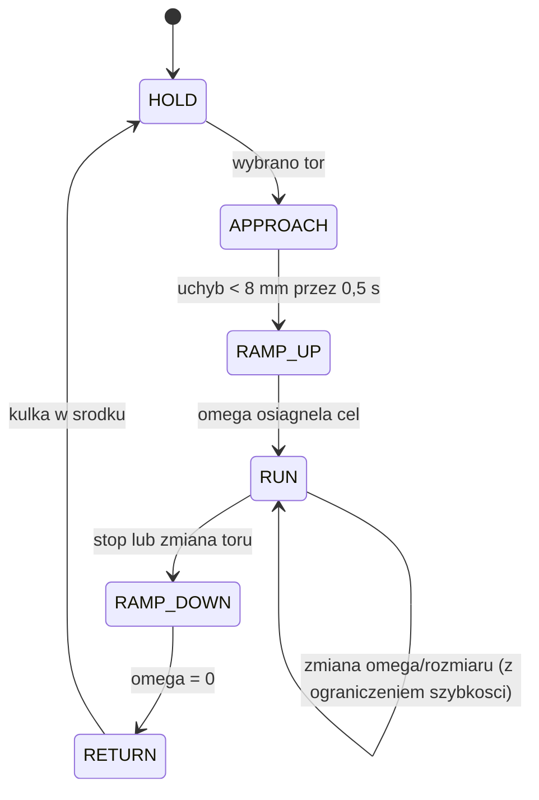

# 25. Firmware: generator trajektorii

Powrót: [[Projekt Ball Balancer]]. Teoria, limity i uzasadnienia: [[12 Trajektorie]]. Regulator: [[22 Firmware - Sterowanie]].

> [!warning] Status kodu
> To **szkielet ustaleń**, nie gotowy program. Kod C++ nie był kompilowany ani uruchamiany. Same wzory (okrąg, ósemka, kwadrat) przepisałem do Pythona i sprawdziłem: prędkość i przyspieszenie z wzorów zgadzają się z różnicowaniem położenia (błąd względny poniżej $10^{-5}$), a tor kwadratu jest zamknięty i ma oczekiwaną długość. Pełny test na komputerze opisuje ostatnia sekcja.

## W skrócie

Generator co 20 ms podaje regulatorowi punkt, w którym ma być kulka ($p_{ref}$), jej prędkość ($v_{ref}$) i przyspieszenie ($a_{ref}$). Wszystko liczymy ze wzorów, a nie przez różnicowanie pomiarów, bo pochodna z szumu byłaby bezużyteczna. Generator działa na rdzeniu 1 razem z regulatorem. Jednostki w generatorze: **mm, mm/s, mm/s²**.

## Typy danych

```cpp
struct Ref {            // jeden punkt toru
  float x, y;           // polozenie [mm]
  float vx, vy;         // predkosc [mm/s]
  float ax, ay;         // przyspieszenie [mm/s^2]
};

enum class Shape : uint8_t { POINT, CIRCLE, EIGHT, SQUARE };

struct TrajParams {
  Shape shape  = Shape::POINT;
  float size   = 40.f;     // promien / polbok [mm], 20..70
  float rc     = 30.f;     // promien rogu kwadratu [mm]
  float omega  = 0.f;      // docelowa predkosc katowa [rad/s], znak = kierunek
  float vLine  = 40.f;     // predkosc po torze kwadratu [mm/s]
  float cx = 0, cy = 0;    // srodek toru [mm]
};
```

## Wartości graniczne

Wartości z [[12 Trajektorie]] zbieramy w jednym miejscu:

```cpp
constexpr float K_MM        = 5886.f;  // mm/s^2 na radian (pingpong); docelowo z pomiaru (patrz nota 18)
constexpr float W_LOOP_MAX  = 1.5f;    // najwyzsza skladowa czestotliwosci toru [rad/s]
constexpr float A_FF_MAX    = 308.f;   // mm/s^2: przyspieszenie z 3 stopni przechylu ff
constexpr float R_MAX       = 70.f;    // maks. wychylenie toru od srodka [mm]
constexpr float DW_MAX      = 0.3f;    // maks. zmiana omega [rad/s^2]
constexpr float DR_MAX      = 15.f;    // maks. zmiana rozmiaru [mm/s]

// maksymalna omega dla danego toru i rozmiaru (stosujemy ostrzejszy z dwoch limitow)
float omegaLimit(Shape s, float size) {
  switch (s) {
    case Shape::CIRCLE: return fminf(W_LOOP_MAX,        sqrtf(A_FF_MAX / size));
    case Shape::EIGHT:  return fminf(W_LOOP_MAX / 2.f,  sqrtf(A_FF_MAX / (2.125f * size)));
    default:            return W_LOOP_MAX;
  }
}
```

## Okrąg i ósemka (wzory analityczne)

Faza $\varphi$ rośnie przyrostowo (`phase += omega*dt`), więc zmiana `omega` w trakcie jazdy nie powoduje skoku położenia. `wdot` to pochodna `omega` (zmiana prędkości kątowej), potrzebna, gdy `omega` narasta.

```cpp
Ref evalCircle(float phase, float w, float wdot, float r) {
  const float c = cosf(phase), s = sinf(phase);
  Ref o;
  o.x  =  r * c;                        o.y  =  r * s;
  o.vx = -r * w * s;                    o.vy =  r * w * c;
  o.ax = -r * w * w * c - r * wdot * s; o.ay = -r * w * w * s + r * wdot * c;
  return o;
}

// x = A sin(phi), y = (A/2) sin(2 phi)
Ref evalEight(float phase, float w, float wdot, float A) {
  const float s1 = sinf(phase), c1 = cosf(phase);
  const float s2 = sinf(2*phase), c2 = cosf(2*phase);
  Ref o;
  o.x  = A * s1;                         o.y  = 0.5f * A * s2;
  o.vx = A * w * c1;                     o.vy = A * w * c2;
  o.ax = -A * w * w * s1 + A * wdot * c1;
  o.ay = -2.f * A * w * w * s2 + A * wdot * c2;
  return o;
}
```

## Kwadrat z zaokrąglonymi rogami

Parametryzacja długością łuku $s$ (mm). Tor składa się z 4 prostych o długości $L_s=2(A-r_c)$ i 4 ćwiartek okręgu o długości $\tfrac{\pi}{2}r_c$. Na prostej przyspieszenie to tylko $\dot v\,\mathbf{t}$, a na łuku dochodzi składowa dośrodkowa $v^2/r_c$.

```cpp
// s: dlugosc luku od poczatku toru; zwraca pozycje, wersor stycznej i krzywizne
void squarePoint(float s, float A, float rc, float &x, float &y,
                 float &tx, float &ty, float &kappa) {
  const float Ls = 2.f * (A - rc);
  const float La = 0.5f * PI * rc;
  const float P  = 4.f * (Ls + La);                // dlugosc calego toru
  s = fmodf(s, P); if (s < 0) s += P;
  const float seg = Ls + La;
  const int   k   = (int)(s / seg);                // 0..3: boki kolejno
  float u = s - k * seg;
  // lokalnie: bok idzie w +x, srodek luku w gorze; potem obrot o k*90 st.
  float lx, ly, ltx, lty, lk;
  if (u < Ls) {                                    // prosta
    lx = -A + rc + u;  ly = -A;  ltx = 1; lty = 0; lk = 0;
  } else {                                         // luk (zakret w lewo)
    const float a = (u - Ls) / rc;                 // kat luku 0..pi/2
    lx = A - rc + rc * sinf(a);
    ly = -A + rc - rc * cosf(a);
    ltx = cosf(a); lty = sinf(a); lk = 1.f / rc;
  }
  const float ang = k * 0.5f * PI, ca = cosf(ang), sa = sinf(ang);
  x  = ca * lx - sa * ly;  y  = sa * lx + ca * ly;
  tx = ca * ltx - sa * lty; ty = sa * ltx + ca * lty;
  kappa = lk;
}

Ref evalSquare(float s, float v, float vdot, float A, float rc) {
  float x, y, tx, ty, k;
  squarePoint(s, A, rc, x, y, tx, ty, k);
  Ref o;
  o.x = x;  o.y = y;
  o.vx = v * tx;  o.vy = v * ty;
  // przyspieszenie: styczne + dosrodkowe (normalna = (-ty, tx))
  o.ax = vdot * tx + v * v * k * (-ty);
  o.ay = vdot * ty + v * v * k * ( tx);
  return o;
}
```

Limity prędkości po torze: $v\le\min(1{,}5\,r_c,\ \sqrt{a_{ff,max}\,r_c})$ ([[12 Trajektorie]]). Dla $r_c=30$ mm to 45 mm/s.

## Ruch punktu zadanego (minimum jerk)

Do przejść między punktami (strzałki, dojazd do początku toru). Zwraca położenie, prędkość i przyspieszenie.

```cpp
struct MinJerk {
  float p0x, p0y, dx, dy, T, t;     // start, wektor ruchu [mm], czas [s], czas biezacy [s]
  bool  active = false;

  void start(float x0, float y0, float x1, float y1) {
    p0x = x0; p0y = y0; dx = x1 - x0; dy = y1 - y0;
    const float d = hypotf(dx, dy);
    T = constrain(d / 30.f, 0.8f, 4.0f);           // ~30 mm/s
    t = 0; active = true;
  }
  Ref step(float dt) {
    t += dt;
    float tau = t / T; if (tau >= 1.f) { tau = 1.f; active = false; }
    const float s1 = 10*tau*tau*tau - 15*tau*tau*tau*tau + 6*tau*tau*tau*tau*tau;
    const float s2 = (30*tau*tau - 60*tau*tau*tau + 30*tau*tau*tau*tau) / T;
    const float s3 = (60*tau - 180*tau*tau + 120*tau*tau*tau) / (T*T);
    Ref o;
    o.x  = p0x + dx * s1;  o.y  = p0y + dy * s1;
    o.vx = dx * s2;        o.vy = dy * s2;
    o.ax = dx * s3;        o.ay = dy * s3;
    return o;
  }
};
```

## Maszyna stanów toru



- **HOLD:** punkt stały, zwykły PID.
- **APPROACH:** `MinJerk` do początku toru.
- **RAMP_UP:** `omega` rośnie ze stałą szybkością `DW_MAX` aż do wartości docelowej.
- **RUN:** jazda; zmiany `omega` i rozmiaru przez ograniczniki szybkości.
- **RAMP_DOWN / RETURN:** wyhamowanie i płynny powrót do środka.

Ogranicznik szybkości zmiany parametru:

```cpp
float slew(float cur, float target, float rate, float dt) {
  const float d = target - cur, m = rate * dt;
  return fabsf(d) <= m ? target : cur + copysignf(m, d);
}
```

## Sterowanie z torem

Regulator `Pid::step` jest jeden i leży w [[22 Firmware - Sterowanie]]. Generator dostarcza mu trzy rzeczy dla każdej osi: `pRef`, `vRef` oraz kąt feed-forward `ffDeg`, który liczymy tak:

```cpp
// aLead: przyspieszenie [mm/s^2] z generatora wywolanego dla chwili t + tLead
float ffAngleDeg(float aLead, float kff) {
  const float ff = kff * (aLead / K_MM) * RAD_TO_DEG;   // [stopnie]
  return constrain(ff, -3.f, 3.f);                      // 3 stopnie na feed-forward
}

// w petli 50 Hz, osobno dla X i Y:
//   Ref now  = traj.eval(t);            // do feedbacku
//   Ref lead = traj.eval(t + tLead);    // tylko do feed-forward
//   tiltX = pidX.step(now.x, now.vx, ffAngleDeg(lead.ax, kff), posX, velX, T, 6.f, freeze);
//   tiltY = pidY.step(now.y, now.vy, ffAngleDeg(lead.ay, kff), posY, velY, T, 6.f, freeze);
```

**Wyprzedzenie:** `eval(t + tLead)` oznacza fazę `phase + omega * tLead` (dla kwadratu `s + v * tLead`). Parametry `kff` i `tLead` stroimy według [[12 Trajektorie]].

**Zamrożenie całki (`freeze`):** ustawiamy, gdy wyjście jest nasycone, kulka jest zgubiona albo toru dotyczy stan APPROACH/RAMP_UP po utracie kulki.

> [!note] Znaki osi
> Który przechył (`tiltX` czy `tiltY`) odpowiada której osi kulki i z jakim znakiem, ustalamy na sprzęcie (parametry `swapXY`, `invX`, `invY`, [[22 Firmware - Sterowanie]]).

## Zachowanie przy awarii

- **LOST** (brak kulki > 0,5 s): generator zatrzymuje fazę (`omega` dąży do 0), stan toru wraca do HOLD, taca się poziomuje ([[22 Firmware - Sterowanie]]).
- **FAULT** (brak ramek z kamery): jak wyżej, a dodatkowo reset całki.
- **Po powrocie kulki:** generator zaczyna od APPROACH (nie od środka toru), żeby nie było skoku.

## Test na komputerze (przed sprzętem)

Generator nie zależy od ESP32, więc można go skompilować na PC (np. jako program testowy w PlatformIO `native`):

1. Dla każdego toru i kilku wartości `omega` całkuj `phase` przez kilka okrążeń.
2. Sprawdź, że **prędkość z generatora ≈ różnica położeń / dt**, a **przyspieszenie ≈ druga różnica położeń / dt²** (tolerancja ok. 1%). Wychwytuje to błędy znaków i pomyłki we wzorach.
3. Sprawdź ciągłość: brak skoków położenia i prędkości przy zmianie `omega`.
4. Sprawdź limity: szczytowe przyspieszenie nie przekracza `A_FF_MAX` w całym zakresie menu.
5. Dla kwadratu sprawdź, że długość toru wynosi $4(L_s+\tfrac{\pi}{2}r_c)$ i że tor jest zamknięty (koniec = początek).

Wyniki zapisz w `firmware/shared/` razem z `protocol.h` ([[23 Firmware - Narzędzia i struktura]]).
