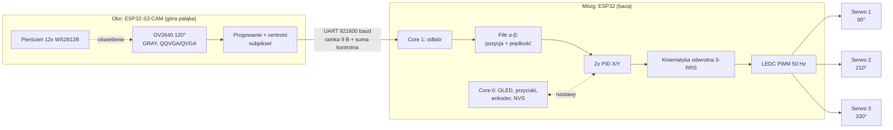

# 🎯 Projekt Ball Balancer 3-RRS (hub)

> [!abstract] W jednym zdaniu
> Autonomiczny (bez PC i Wi-Fi) stół, który **utrzymuje kulkę w zadanym punkcie lub prowadzi ją po trajektorii**. Taca $\varnothing 210$ mm jest przechylana przez 3 serwa Hitec HS-422 (układ 3-RRS co $120^\circ$). Pozycję kulki mierzy kamera na pałąku C-Arm. Nastawy zmienia się lokalnie: OLED, 4 strzałki, przycisk DALEJ i enkoder.

**Notatki projektu**
- [[Ball Balancer - Obliczenia]]: kinematyka, dynamika kulki, PID, kamera, zasilanie, momenty.
- [[Ball Balancer - Uwagi i ulepszenia]]: przegląd dokumentacji, błędy, ryzyka, zmiany względem v1.
- [[Ball Balancer - Firmware]]: protokół UART, kinematyka odwrotna w C++, PID, zadania FreeRTOS, UI.
- Źródło (ustalenia v1, w tym gotowy kod OpenSCAD cięgien): [[dokumentacja_projektowa_ball_balancer_3_rrs]]

---

## 1. Jak to działa

**Dlaczego dwa mikrokontrolery.** Odświeżanie OLED po I²C trwa kilkadziesiąt ms i blokowałoby pętlę sterowania albo odbiór klatek. Dwa układy rozdzielają te zadania sprzętowo, a UART 921600 baud przesyła ramkę w mniej niż 0,1 ms.

---

## 2. Decyzje projektowe (stan: v2)

Kolumna „v2" zawiera poprawki z przeglądu. Uzasadnienia są w [[Ball Balancer - Uwagi i ulepszenia]].

| Obszar | v1 (dokumentacja) | v2 (ustalone teraz) |
| :--- | :--- | :--- |
| Rozdzielczość kamery | QQVGA $160\times120$ | Start od QQVGA z centroidem subpikselowym. Test QVGA $320\times240$, jeśli FPS $\ge 50$. |
| Korekcja obiektywu 120° | brak | Mapowanie piksele → mm z uwzględnieniem dystorsji. Parametr $f$ z kalibracji. |
| Ekspozycja | automatyczna | Zablokowane AEC/AGC/AWB, ekspozycja $\le 5$ ms. |
| Ramka UART | 5 B, nagłówek `0xFF` | 9 B: nagłówek 2 B, numer, flagi, X, Y, suma XOR. |
| Pętla sterowania | wg klatek kamery (50–60 Hz) | Stałe 50 Hz zsynchronizowane z PWM serw (analogowy HS-422 przyjmuje 50 Hz). |
| Regulator | PID, nastawy do ustalenia | PD + wolne I, pochodna z filtra α-β, anty-windup. Start: patrz [[Ball Balancer - Obliczenia#5. Regulator PID]]. |
| Limit przechyłu | $\pm 9^\circ$ | Programowo $\pm 6^\circ$ (zakres sprzętowy: $7{,}9$–$10{,}2^\circ$ zależnie od kierunku). |
| Zasilacz | 5 V 3 A (lub 4 A) | **5 V / 4 A** |
| Enkoder KY-040 | zasilanie nieokreślone | Zasilany z **3,3 V** (moduł ma pull-upy do VCC). |
| Dane WS2812B | wprost z ESP32-S3 | Przez konwerter poziomów (74AHCT125) lub zasilanie pierścienia ok. 4,3 V. |
| Etykiety serw 2 i 3 | 210° = przód-prawo | 210° = **przód-lewo** (widok z góry, serwo 1 z tyłu). Patrz sekcja 4. |
| $Z_{neutral}$ | 92 mm | Do przeliczenia z modelu (pivot nad osią = 83,0 mm). Patrz uwagi. |

---

## 3. Geometria (skrót)

Pełna tabela jest w [[dokumentacja_projektowa_ball_balancer_3_rrs]].

| Parametr | Wartość |
| :--- | :--- |
| Taca | $\varnothing 210$ mm, płyta 3 mm + 6 żeber 5 mm, rant 2×3,5 mm, powierzchnia robocza $\varnothing 206$ mm |
| Promień podparcia $R_{plate}$ i osi serw $R_{base}$ | 90 mm (oba) |
| Wysokość osi serwa $Z_{servo}$ | 28 mm |
| Orczyk $L_1$ | 24 mm |
| Popychacz $L_2$ | 60 mm (54,4 mm + 2×2,8 mm kostki Kardana) |
| Skok pionowy przy $\pm 35^\circ$ | $\pm 13{,}8$ mm |
| Wysięg C-Arm | 132 mm od środka |
| Kamera nad tacą | 195 mm (całość od blatu ok. 290 mm) |
| Konsola | $120\times62$ mm pod kątem $40^\circ$, między serwami 2 i 3 |

**Kąty serw (widok z góry, serwo 1 z tyłu):**
- Serwo 1 (tył): $\psi_1 = 90^\circ$, zintegrowane z podstawą pałąka.
- Serwo 2 (przód-lewo): $\psi_2 = 210^\circ$.
- Serwo 3 (przód-prawo): $\psi_3 = 330^\circ$.

---

## 4. Lista części i zakupy

### ✅ Mamy (0 zł)
- [x] Drukarka 3D + PLA/PETG
- [x] ESP32 (baza), OLED I²C
- [x] 3× Hitec HS-422 (40,6×19,8×36,6 mm; 3,3 kg·cm przy 4,8 V, 4,1 kg·cm przy 6 V)
- [x] 3× SG90 (rezerwa)
- [x] Kondensatory elektrolityczne $\ge 1000\,\mu$F / 10 V
- [x] Śruby i nakrętki M2, M3

### 🛒 Do kupienia
- [ ] ESP32-S3-WROOM N16R8 CAM, 2× USB-C (~38–45 zł)
- [ ] Kamera OV2640 **120°**, taśma 24-pin (~15 zł). Wbudowany obiektyw ok. 65° nie obejmie tacy z 195 mm.
- [ ] Pierścień LED 12× WS2812B, ~37–50 mm (~7 zł)
- [ ] Enkoder KY-040 + gałka (~6 zł)
- [ ] 5× Tact 12×12×7,3 mm + 5 nasadek (~5 zł)
- [ ] Zasilacz **5 V / 4 A** + gniazdo DC 5,5/2,1 mm (~20–25 zł)
- [ ] Czarna matowa folia/okleina + matowe piłeczki 40 mm, białe lub pomarańczowe (~10 zł)

### ➕ Dodatki, które dokumentacja pomija (~20–30 zł)
- [ ] Konwerter poziomów 74AHCT125 (lub dioda na VDD pierścienia)
- [ ] Śruby **M2×18–20** (12 szt.) + nakrętki M2 samohamowne (12 szt.). M2×16 daje w nakrętce zaledwie 1–2 zwoje.
- [ ] Włącznik zasilania, bezpiecznik/PTC ok. 5 A
- [ ] Płytka uniwersalna, przewody silikonowe, złącza goldpin
- [ ] Kondensatory 100 µF i 100 nF przy każdym serwie
- [ ] Biała kartka lub dyfuzor na pierścień LED
- [ ] Klej/zalewka do folii, cienkie podkładki M2

**Realistyczny budżet: ok. 130–140 zł** (v1 podawało 100–110 zł).

---

## 5. Pinout (po korektach)

### Dolne ESP32 (baza)

| Funkcja | GPIO | Uwagi |
| :--- | :--- | :--- |
| OLED SDA / SCL | 21 / 22 | I²C 400 kHz, odświeżanie 10–15 Hz na Core 0 |
| UART RX / TX (kamera) | 16 / 17 | Serial2. **Sprawdź, czy to WROOM-32, a nie WROVER** (w WROVER te piny zajmuje PSRAM). Krzyżowo z TX/RX kamery, wspólna masa. |
| Serwo 1 / 2 / 3 | 25 / 26 / 27 | LEDC 50 Hz, 14 bit. Podłączać (attach) dopiero po ustawieniu pozycji startowej. |
| Enkoder CLK / DT / SW | 32 / 33 / 15 | Zasilanie modułu z 3,3 V. GPIO 15 to pin strappingowy: nie trzymać wciśniętego SW przy starcie. |
| Strzałki GÓRA / DÓŁ / LEWO / PRAWO | 18 / 19 / 23 / 4 | `INPUT_PULLUP`, drugi styk do GND |
| DALEJ (MODE) | 13 | `INPUT_PULLUP` |

Ekrany przycisku DALEJ: `1 Radar` → `2 Trajektorie` → `3 PID` → `4 Trim serw` → `5 Kalibracja kamery` (nowy, patrz [[Ball Balancer - Firmware]]).

### ESP32-S3 CAM (oko)
Dokładny pinout zależy od płytki. Typowo wolne są m.in. GPIO 1, 2, 14, 47, 48. **Uwaga:** na N16R8 piny GPIO 35–37 są zajęte przez PSRAM. Sprawdź pinout swojej płytki przed lutowaniem.
- UART1: TX → RX głównego ESP32 (GPIO 16), RX ← TX (GPIO 17).
- Dane WS2812B: jeden wolny GPIO przez konwerter poziomów.

---

## 6. Elementy do druku

| Plik | Szt. | Status |
| :--- | :--- | :--- |
| `01_Baza_Glowna_HS422.stl` | 1 | do zaprojektowania (OpenSCAD #2) |
| `02_Panel_Konsoli_OLED.stl` | 1 | do zaprojektowania (OpenSCAD #2) |
| `03_Taca_Robocza_210mm.stl` + `03b_Rant_210mm.stl` | 1+1 | do zaprojektowania (OpenSCAD #3) |
| `04_Adapter_Orczyka_24mm.stl` | 3 | **gotowy** (kod w dokumentacji) |
| `05_Popychacz_60mm.stl` | 3 | **gotowy** |
| `05b_Kostka_Kardana.stl` | 6 | **gotowy** |
| `05c_Uchwyt_Pod_Tace.stl` | 3 | **gotowy**, ale zweryfikuj `pivot_h` (patrz [[Ball Balancer - Uwagi i ulepszenia]]) |
| `06_Palak_Dolny.stl` + `07_Palak_Gorny_Kamera.stl` | 1+1 | do zaprojektowania (OpenSCAD #3) |

**Ustawienia druku cięgien:** warstwa 0,16–0,20 mm, 4 obrysy, wypełnienie 100%, bez podpór. Komplet (`part_select = 0`) drukujemy 3 razy.

**Dodatkowo (rekomendacja):** przed drukiem całości wydrukuj **jedno cięgno z jedną kostką i adapterem** i sprawdź luz oraz płynność ruchu (tolerancje 8,4 mm szczeliny i 8,0 mm kostki).

---

## 7. Plan prac

- [ ] **Etap 0. Zakupy.** Zamów części z sekcji 4 razem z dodatkami.
- [ ] **Etap 1. Test mechaniki.** Wydrukuj 1 zestaw cięgien, sprawdź luz i swobodę kostek. Dopasuj `fork_gap` i otwory.
- [ ] **Etap 2. CAD.** Baza + konsola (OpenSCAD #2), taca + pałąk (OpenSCAD #3). Sprawdź kolizje: taca ↔ konsola przy przechyle 9° (krawędź tacy opada ok. 16 mm), taca ↔ słupek pałąka.
- [ ] **Etap 3. Elektronika na biurku.** Zasilanie 5 V, serwa, kondensatory. Test PWM bez obciążenia, kalibracja 1500 µs.
- [ ] **Etap 4. Firmware kamery.** Podgląd obrazu przez serial, ekspozycja, próg, centroid, UART, LED.
- [ ] **Etap 5. Firmware bazy.** Kinematyka odwrotna z symulowanym przechyłem, UI, NVS, następnie pętla PID.
- [ ] **Etap 6. Integracja i strojenie.** Najpierw kulka na płaskiej tacy (test statyczny), potem strojenie wg [[Ball Balancer - Obliczenia#5. Regulator PID]].
- [ ] **Etap 7. Wykończenie.** Folia, rant, okablowanie w tunelu, dyfuzor LED, etykiety.

---

## 8. Kolejne sesje (zadania generatywne)

1. OpenSCAD #2: `01_Baza_Glowna_HS422` + `02_Panel_Konsoli_OLED`.
2. OpenSCAD #3: `03_Taca` + `06/07_Palak_C_Arm` (M3 w $R=90$ mm, rozstaw 20 mm, wysokość kamery 195 mm).
3. Firmware ESP32-S3 CAM (QQVGA/QVGA gray, centroid, LED, UART).
4. Firmware ESP32 (PID, IK, UI, NVS). Szkielet jest już w [[Ball Balancer - Firmware]].

> [!tip] Zasada dla kodu OpenSCAD
> Cały kod OpenSCAD generujemy w czystym ASCII, bez polskich znaków nawet w komentarzach. Parser w przeglądarkowym `/playground.scad` bywa na nie wrażliwy.
